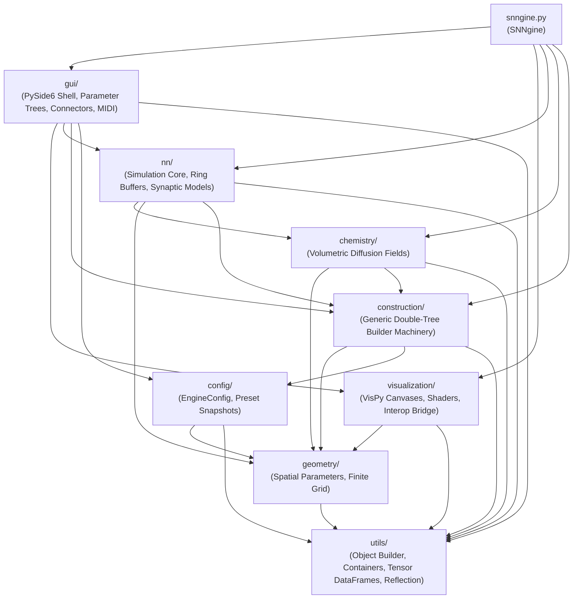
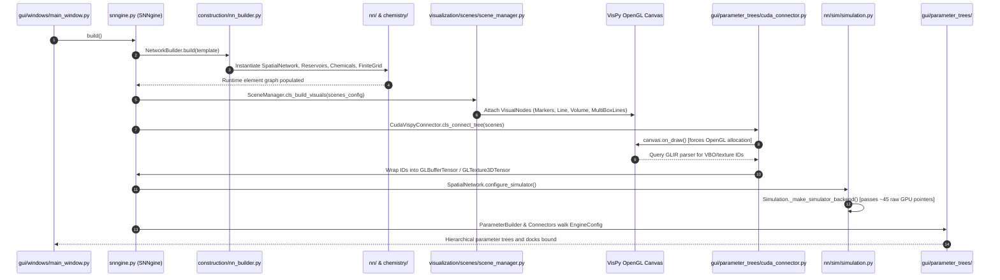
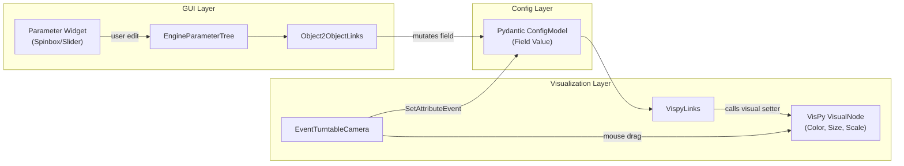
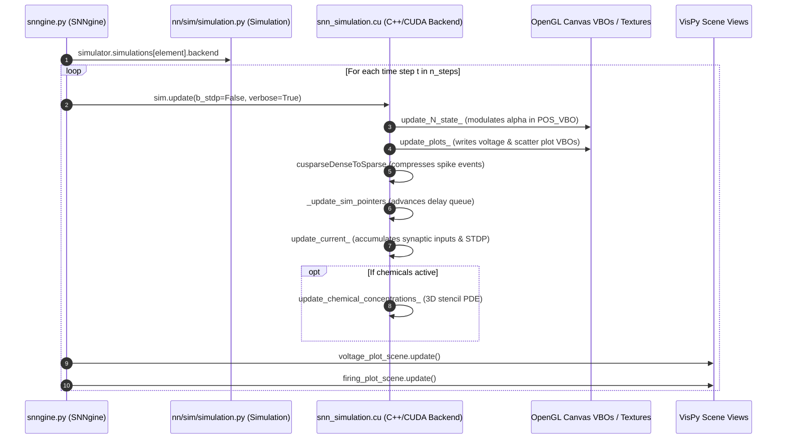
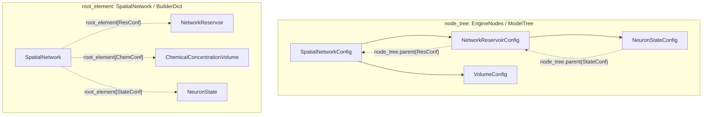
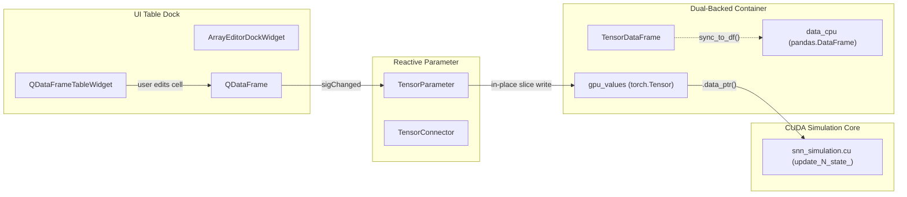

# Module interactions and system-wide dataflow

This document details the cross-subpackage dependencies, end-to-end orchestration flow, shared GPU buffer contracts, and reactive event topologies across `snngine_v4/`.

---

## 1. Subpackage dependency hierarchy

The engine architecture is structured into six conceptual layers. With one noted exception (`gui/app_settings.py` imported upstream by `config/app.py`), package dependencies flow strictly downward:



### Layer descriptions:
1. **Foundation (`utils/`)**: Provides domain-agnostic infrastructure: reflective factory engine (`ModelObjectBuilder`), type-enforced and bidirectional containers (`Object2ObjectMap`, `ModelTree`), dual-backed CPU/GPU tabular models (`TensorDataFrame`), Pydantic settings bases (`XMLSettingsModel`), and array validators.
2. **Configuration & spatial vocabulary (`config/`, `geometry/`)**: Defines declarative schemas for engine settings (`EngineConfig`), device requirements (`DeviceSettings`), canvas setups (`SceneSettings`), spatial parameter vocabulary (`AxDir3D`, `XYZPars`), volumetric shapes (`VolumeShapeHDW`), and finite grid specifications (`FiniteGridConfig`).
3. **Instantiation machinery (`construction/`)**: Implements the declarative Double-Tree Architecture (`node_tree` vs. `root_element`) and recursive build cascade (`NetworkBuilder`), decoupling domain configuration from runtime graph execution.
4. **Domain modeling & compute (`nn/`, `chemistry/`)**: Encapsulates neural network state (`NeuronState`), synaptic topology generation (`Synapses`, `SynCounts`), 3D chemical diffusion fields (`ChemicalConcentrationVolume`), and CUDA backend execution (`Simulation`).
5. **Rendering & GPU interop (`visualization/`)**: Manages VisPy canvas viewports (`SceneManager`), custom OpenGL wireframe geometry shaders (`MultiBoxLinesVisual`), volume renderers (`CompoundR32fVolumeVisual`), and the PyCUDA/PyTorch memory mapping bridge (`GLBufferTensor`, `GLTexture3DTensor`).
6. **Application shell & reactive connectors (`gui/`)**: Provides the PySide6 multi-dock interface (`MainEngineWindow`), schema-driven parameter inspection (`EngineParameterTree`), out-of-band GPU buffer resolution (`CudaVispyConnector`), visual event synchronizers (`VispyConnector`), and hardware MIDI mapping (`EngineLinkerTree`, `XTouchMiniDevice`).
7. **Central coordinator (`snngine.py`)**: Houses `SNNgine`, driving the master multi-phase build sequence and simulation stepping loop.

---

## 2. End-to-end orchestration lifecycle (`SNNgine.build`)

When the application launches via `MainEngineWindow.construct_network` (`snngine_v4/gui/windows/main_window.py`), execution passes to `SNNgine.build` (`snngine_v4/snngine.py`), which orchestrates five sequential phases across subpackages:



### Phase details:
1. **Domain graph instantiation (`build_network`)**:
   - `SNNgine` passes `self.conf.template` to `NetworkBuilder.build()`.
   - `NetworkBuilder` deep-copies the template and recursively walks child models using `BUILDER_OBJECT_CLASS_MAP`.
   - `SpatialNetwork` instantiates `NetworkReservoir`, `FiniteGrid`, `NeuronState`, `Synapses`, and `ChemicalConcentrationVolume`.
   - Elements register into the flat root registry `root_element` and populate instance attributes via `set_tensor_attr`.
2. **Visual scene construction (`build_visuals`)**:
   - `SNNgine.build_visuals` passes canvas configuration (`SceneSettings`) to `SceneManager.cls_build_visuals`.
   - `VispyVisualBuilder.get_model` converts simulation models (`NetworkReservoirConfig`, `FiniteGridConfig`, `VolumeConfig`) into visual configuration models (`MarkersVisualConfig`, `OuterGridVisualInitConfig`, `R32fVolumeVisual`).
   - Visual nodes are attached to VisPy viewboxes (`main_scene`, `multiplot_voltage`, `multiplot_firings`).
3. **GPU interop buffer registration (`build_cuda_gl_tensors`)**:
   - `CudaVispyConnector.cls_connect_tree` forces an initial draw on all canvases (`canvas.on_draw(None)`), compelling VisPy to allocate underlying OpenGL buffer objects.
   - `CudaVispyConnector.to_gl_buffer` extracts raw OpenGL buffer IDs from VisPy's GLIR parser (`obj._vbo.id`, `obj._texture.id`).
   - Buffer IDs are wrapped into `GLVBOTensor` or `GLTexture3DTensor` and stored in `SpatialNetwork.cuda_opengl_map`.
4. **Simulation backend pointer handoff (`configure_simulator`)**:
   - `Simulation._make_simulator_backend` resolves device memory pointers (`.data_ptr()`) across neuron states, synapses, chemical volumes, and mapped OpenGL plot VBOs.
   - Pointers are passed into the C++/CUDA constructor `snn_simulation_gpu.SnnSimulation`.
5. **Reactive UI binding (`connect_visuals` & `connect_tensors`)**:
   - `VispyConnector` attaches `VispyLinks` between Pydantic models and VisPy visuals.
   - `TensorConnector` binds parameter nodes to live tensors in `EngineElement.tensor_dict`.
   - `ParameterBuilder` generates `EngineParameterTree` docks for interactive inspection.

> [!NOTE]
> **Headless reference implementation**: For headless cloud environments without X11/PySide6 displays, Phases 1–4 are executed standalone by mocking OpenGL VBO buffers with matching CUDA tensors in [`test_headless_engine_sim.py`](file:///E:/dev/snngineV4_agent_branches/setups/runpod-engine-smoke-test/test_headless_engine_sim.py), allowing the complete simulation pipeline to execute and step without GUI or canvas initialization.

---

## 3. Cross-subpackage shared buffer contracts

Several GPU memory buffers cross architectural boundaries to enable zero-copy computation and rendering without CPU transfers:

| Buffer Identifier | Config Source | Runtime Owner | Rendering Consumer | CUDA Simulation Consumer | Interop Mechanism |
| :--- | :--- | :--- | :--- | :--- | :--- |
| **`POS_VBO`** | `nn/config_models/reservoir/nn_reservoir_config.py` (`pos`) | `NetworkReservoir.pos_vbo` | `vispy.scene.visuals.Markers` (`main_scene`) | `snn_simulation.cu` (`N_pos`, stride 14, alpha offset 10) | **Zero-Copy**: OpenGL VBO $\rightarrow$ PyCUDA `RegisteredBuffer` $\rightarrow$ `numba.cuda` $\rightarrow$ `torch.as_tensor` |
| **`voltage_plot_data`** | `nn/sim/sim_parameters.py` (`plots.voltage_plot`) | `PlotElement.pos_vbo` | `vispy.scene.visuals.Line` (`multiplot_voltage`) | `snn_simulation.cu` (`voltage_plot_data`) | **Zero-Copy**: Line vertex buffer wrapped directly into PyTorch tensor |
| **`scatter_plot_data`** | `nn/sim/sim_parameters.py` (`plots.firings_scatter_plot`) | `PlotElement.pos_vbo` | `CompoundMarkersVisual` (`multiplot_firings`) | `snn_simulation.cu` (`scatter_plot_data`, stride 14) | **Zero-Copy**: Compound marker VBO written directly by CUDA spike raster kernel |
| **`C0` 3D Texture** | `chemistry/chem_models.py` (`DefaultChemicals.C0`) | `ChemicalConcentrationVolume.texture_3d_tensor` | `R32fVolumeVisual` (`main_scene`) | `snn_simulation.cu` (`C_old`, `C_new`, `C_source`) | **GPU-to-GPU Copy**: `GLTexture3DTensor` manages independent PyTorch tensor, synced via `pycuda.driver.Memcpy3D` |

---

## 4. Reactive event propagation topology

Interactive modifications in the GUI propagate across modules while preserving domain independence:



### Event rules:
1. **Parameter edits to visuals**: When a user changes a parameter in `EngineParameterTree`, `Object2ObjectLinks` mutates the underlying Pydantic model field, which triggers `VispyLinks` to update visual node properties (`color`, `size`, `visible`) directly on the GPU without regenerating the visual or restarting the simulation.
2. **Camera manipulation to config**: Interactive turntable mouse dragging in VisPy viewboxes is intercepted by `EventTurntableCamera` (`visualization/scenes/event_camera.py`), which emits `SetAttributeEvent` to update camera parameters (`azimuth`, `elevation`, `distance`, `fov`) in `TurnTableCameraParameters`, ensuring camera state is preserved during XML serialization.
3. **Shared array mutation guard**: In two-way bindings where a property maps to an underlying GPU buffer (e.g. neuron positions in `'pos'`), `SHARED_RUNTIME_FIELDS` enforces in-place array updates (`arr[:] = value`). Any attempt to reassign the field to a new array instance raises `RuntimeError`, preventing UI bindings from orphaning mapped OpenGL VBO pointers.

---

## 5. Time-stepped simulation loop interactions (`SNNgine.run_sim`)

When stepping the active simulation via `SNNgine.run_sim` ([`snngine.py`](file:///E:/dev/snngineV4_agent_branches/snngine_v4/snngine.py)), execution coordinates between Python orchestration, CUDA compute kernels, and VisPy canvas redraw dispatch:



### Stepping sequence details:
1. **ODE integration and visual spike modulation (`update_N_state_`)**:
   - Integrates membrane potential differential equations (e.g. Izhikevich ODEs: $v' = 0.04v^2 + 5v + 140 - u + i$) in single precision.
   - Injects sensory and thalamic currents from `G_props`.
   - Detects threshold crossing ($v > 30\text{ mV}$), resetting spiked neurons ($v \leftarrow c, u \leftarrow u + d$) and setting boolean spike indicators in `fired[n]` and `last_fired[n]`.
   - Modulates the alpha channel in the neuron position buffer `N_pos[n * 14 + 10]` ($1.0$ for firing, $0.3$ resting) directly within the mapped VisPy `POS_VBO`.
   - Accumulates group firing counts into `G_firing_count_hist`.
2. **Plot VBO streaming (`update_plots_`)**:
   - Invokes `update_voltage_plot_`, reading monitored neuron voltages from `N_states` and streaming them directly into the `Line` vertex buffer `voltage_plot_data` at `start_idx + 2 * t + 1`.
   - Invokes `update_scatter_plot_`, streaming spike raster markers into `scatter_plot_data` at `start_idx + 14 * t + 10`.
3. **cuSPARSE spike compression**:
   - Executes `cusparseDenseToSparse_analysis` and `cusparseDenseToSparse_convert`, transforming the dense boolean array `fired` into CSR sparse representation (`firing_times_sparse`, `firing_counts_write`, `firing_idcs_write`).
4. **Delay line queue advancement (`_update_sim_pointers`)**:
   - Updates circular ring buffer pointers for conduction delay queues ($D$), tracking write heads (`firing_times_write`, `firing_idcs_write`) and read heads (`firing_times_read`, `firing_idcs_read`).
5. **Synaptic current propagation & STDP (`update_current_`)**:
   - Reads incoming spikes delayed by `N_delays`, resolves post-synaptic targets `snk_N = N_rep[idx]`, and accumulates synaptic weights into target neuron currents (`atomicAdd(&N_states[snk_N + 7 * N], w1)`).
   - When STDP is active (`b_stdp && t > no_stdp_time_threshold`), updates synaptic weights `N_weights[idx]` according to reward/punishment STDP equations.
6. **Chemical volume diffusion (`update_chemical_concentrations_`)**:
   - When active, runs a 3D 6-point finite-difference stencil PDE over shared concentration grids `C_old`, `C_new`, and source terms `C_source`.
7. **Host canvas redraw dispatch**:
   - `voltage_plot_scene.update()` schedules redrawing of the voltage trace canvas.
   - `firing_plot_scene.update()` schedules redrawing of the spike raster canvas.

### Verified execution gaps:
- **Neuron canvas update omitted**: `main_scene.update()` is not called inside `run_sim`. Although `update_N_state_` writes neuron alpha values directly into the mapped `POS_VBO`, VisPy does not redraw the 3D marker canvas during simulation steps unless camera motion or external refresh triggers it.
- **3D texture transfer omitted**: `copy_to_texture()` ([`GLTexture3DTensor`](file:///E:/dev/snngineV4_agent_branches/snngine_v4/visualization/cuda/gl_texture_3d_tensor.py)) is not called during `run_sim`. Chemical diffusion calculations advance in PyTorch device memory (`C_new`, `C_old`), but the OpenGL 3D texture backing the volumetric visual remains static until explicitly transferred.
- **No background timer**: Standard GUI execution does not currently attach a continuous timer (`QTimer` / `vispy.app.Timer`) to `run_sim`; stepping is invoked programmatically or via manual UI test hooks.

---

## 6. Double-Tree navigation & runtime element resolution protocol

The engine decouples declarative schema configuration from executable domain graphs using a cooperative Double-Tree pattern:



### Navigation protocol:
1. **Declarative model tree (`node_tree`)**:
   - An instance of `EngineNodes` ([`engine_element.py`](file:///E:/dev/snngineV4_agent_branches/snngine_v4/construction/engine_element.py)), which specializes `ModelTree` ([`node_map.py`](file:///E:/dev/snngineV4_agent_branches/snngine_v4/utils/containers/node_map.py)).
   - Stores hierarchical relationships exclusively between Pydantic configuration instances (`TreeNode`).
2. **Flat runtime registry (`root_element`)**:
   - The top-level `SpatialNetwork` acts as `root_element`. It inherits `BuilderDict` and `Object2ObjectMap` ([`mappings.py`](file:///E:/dev/snngineV4_agent_branches/snngine_v4/utils/containers/mappings.py)).
   - Holds a flat, bidirectional mapping from every configuration model instance to its constructed runtime execution object (`root_element[model] = element`).
3. **Parent resolution (`parent_element()`)**:
   - Rather than storing hard object references that could cause circular leaks, child elements navigate upward dynamically:
     ```python
     def parent_element(self):
         parent_model = self.node_tree.parent(self.config)
         return self.root_element[parent_model]
     ```
4. **Child resolution (`children_elements`)**:
   - Children are resolved dynamically by querying the configuration tree for child models and retrieving the active instances from the root registry:
     ```python
     @property
     def children_elements(self):
         return [self.root_element[x] for x in self.node_tree.children(self.config)]
     ```
5. **Global registration cascade (`__setitem__`)**:
   - When any descendant `EngineElement` registers a constructed object (`self[model] = obj`), `EngineElement.__setitem__` delegates to `self.root_element[key] = value`, ensuring that every constructed element across subpackages is centrally accessible via the root dictionary.

---

## 7. Hardware MIDI controller parameter mapping pipeline

Physical USB MIDI control surfaces integrate seamlessly into the reactive parameter framework:

```mermaid
flowchart LR
    subgraph Hardware Layer
        USB["Behringer X-Touch Mini<br/>(Rotary Knobs, Buttons, Fader)"]
    end

    subgraph Device Layer
        Dev["XTouchMiniDevice<br/>(mido / rtmidi)"]
        State["XTMState / XTMConfig<br/>(Encoder Values, Layers A/B)"]
        DevWdg["XTMDeviceWidget<br/>(Virtual Photorealistic UI)"]
    end

    subgraph Linker Subsystem
        LTree["EngineLinkerTree"]
        Action["ControllerAction"]
        RMap["RangeMap<br/>(0..127 to param range)"]
    end

    subgraph Target Parameter
        Param["pyqtgraph Parameter"]
        Model["Pydantic ConfigModel"]
        Visual["VisPy VisualNode"]
    end

    USB -->|"MIDI packets"| Dev
    Dev -->|"update_from_message"| State
    State -->|"signals"| DevWdg
    DevWdg -->|"sigDeviceInput"| Action
    Action -->|"evaluates"| RMap
    RMap -->|"set_parameter_value"| Param
    Param -->|"mutates"| Model
    Model -->|"VispyLinks"| Visual
```



### Pipeline stages:
1. **MIDI packet ingestion**: `XTouchMiniDevice` ([`x_touch_mini_device.py`](file:///E:/dev/snngineV4_agent_branches/snngine_v4/gui/devices/x_touch_mini/x_touch_mini_device.py)) opens asynchronous MIDI streams using `mido` / `rtmidi`. Incoming Control Change (CC), Note On/Off, and SysEx packets are passed to `_device_config.update_from_message`.
2. **Controller state tracking**: `XTMConfig` and `XTMState` ([`xtm_state.py`](file:///E:/dev/snngineV4_agent_branches/snngine_v4/gui/devices/x_touch_mini/xtm_state.py)) maintain internal state across 8 continuous rotary encoders, 16 backlit buttons, layer A and B selection, and 1 master fader, emitting Qt signals through `XTMDeviceWidget` ([`xtm_device_wdg.py`](file:///E:/dev/snngineV4_agent_branches/snngine_v4/gui/devices/x_touch_mini/xtm_ui/xtm_device_wdg.py)).
3. **Interactive assignment interface**: `EngineLinkerTree` ([`engine_linker_tree.py`](file:///E:/dev/snngineV4_agent_branches/snngine_v4/gui/parameter_trees/linker_tree/engine_linker_tree.py)) and `XTMLinkerWindow` ([`xtm_linker_widgets.py`](file:///E:/dev/snngineV4_agent_branches/snngine_v4/gui/parameter_trees/linker_tree/xtm_linker_widgets.py)) allow users to bind any parameter in the tree to a physical knob, button, or fader.
4. **Dynamic range mapping (`RangeMap`)**: `RangeMap` ([`range_map_widget.py`](file:///E:/dev/snngineV4_agent_branches/snngine_v4/gui/parameter_trees/linker_tree/range_map_widget.py)) scales 7-bit MIDI integer inputs $[0, 127]$ into target parameter intervals ($[\text{min}_1, \text{max}_1]$), respecting hard bounds and step sizes.
5. **Action dispatch (`ControllerAction`)**: `ControllerAction.connect_parameter()` ([`controls_map.py`](file:///E:/dev/snngineV4_agent_branches/snngine_v4/gui/parameter_trees/linker_tree/controls_map.py)) connects widget signals (`valueChanged`, `sigDeviceInput`) to `set_parameter_value(value)` or `toggle_parameter()`. Calling `parameter.setValue(value)` mutates the underlying Pydantic model field, propagating instantly through `VispyLinks` to GPU visual attributes.

---

## 8. Tabular state synchronization protocol (`TensorDataFrame` $\leftrightarrow$ `QDataFrameTableWidget`)

Tabular network states (e.g. neuron parameters $a, b, c, d, v, u$, group flags, synaptic counts) maintain two-way synchronization between host Pandas tables and PyTorch GPU tensors:



### Synchronization mechanics:
1. **Dual backing architecture**: `TensorDataFrame` and `TensorSeries` ([`tensor_dataframe.py`](file:///E:/dev/snngineV4_agent_branches/snngine_v4/utils/cuda_utils/tensor_dataframe.py)) maintain a CPU `pandas.DataFrame` coupled with a GPU `torch.Tensor` (`gpu_values`). Named rows and columns are governed by Pydantic models (`IndexConfig`, `Row`, `Column`).
2. **Interactive table dock**: `ArrayEditorDockWidget` and `QDataFrameTableWidget` ([`df_table_widget.py`](file:///E:/dev/snngineV4_agent_branches/snngine_v4/gui/parameters/widgets/table/df_table_widget.py)) host `QDataFrame` ([`q_dataframe.py`](file:///E:/dev/snngineV4_agent_branches/snngine_v4/gui/parameters/widgets/table/q_dataframe.py)), displaying state variables in an editable spreadsheet.
3. **In-place tensor modification**: When a cell or column is edited:
   - `qdf.sigChanged` emits with a `DataChangeType` notification.
   - `TensorParameter.onDataChanged` ([`tensor_parameter.py`](file:///E:/dev/snngineV4_agent_branches/snngine_v4/gui/parameters/array/tensor_parameter.py)) intercepts the change:
     - `DataChangeType.CELL_UPDATED`: Writes directly to the tensor slice: `self.tensor[row, col] = torch.from_numpy(...)`.
     - `DataChangeType.COLUMN_VALUE_UPDATED`: `self.tensor[:, col] = value`.
     - `DataChangeType.INDEX_VALUE_UPDATED`: `self.tensor[row, :] = value`.
4. **Device pointer invariance**: Because in-place tensor slice assignments do not alter the underlying device memory address, the raw memory pointer (`gpu_values.data_ptr()`) held by C++/CUDA kernels remains valid, allowing interactive property updates without restarting the simulation backend or reallocating memory.

---

## 9. SNNgine3D legacy differences (system-wide cross-check)

A comparative architectural audit against legacy `SNNgine3D` highlights how cross-module orchestration, data ownership, visual coupling, and runtime execution loops were redesigned in `snngine_v4`:

| Architectural Dimension | Legacy SNNgine3D (`snngine3d/`) | Modern snngine_v4 (`snngine_v4/`) | Architectural Impact |
| :--- | :--- | :--- | :--- |
| **System Orchestration** | Monolithic `Engine` (`engine.py`) imperatively constructed UI, VisPy, and simulation objects in an interleaved sequence. | Decoupled `SNNgine` ([`snngine.py`](file:///E:/dev/snngineV4_agent_branches/snngine_v4/snngine.py)) drives a 5-phase lifecycle via specialized builders. | Eliminates circular construction dependencies and isolates domain instantiation from GUI state. |
| **Domain-Visual Coupling** | Visual inheritance via `VspNN` (`v_neuron_representation.py`, `v_simulation.py`) and `CudaNode`; domain classes held VisPy visuals directly. | Clean decoupling: domain classes have zero visual inheritance. Out-of-band connectors ([`VispyConnector`](file:///E:/dev/snngineV4_agent_branches/snngine_v4/gui/parameter_trees/vispy_connector.py)) bind them via `VispyLinks`. | Domain models can instantiate and run headlessly without OpenGL or Qt dependencies. |
| **Execution Loop Driver** | Single `vispy.app.Timer('auto')` on the Qt GUI thread drove both CUDA simulation stepping and canvas redraws. | Decoupled execution loop: [`SNNgine.run_sim`](file:///E:/dev/snngineV4_agent_branches/snngine_v4/snngine.py) executes independently of UI timers; canvas updates are dispatched selectively. | Enables standalone headless benchmarking and batch stepping without active GUI event loops. |
| **Element Hierarchy Navigation** | Monolithic element trees held hard bidirectional Python object references. | Declarative Double-Tree pattern: configuration tree (`node_tree: EngineNodes`) guides resolution in flat runtime registry (`root_element: SpatialNetwork`). | Prevents reference cycles, guarantees clean garbage collection, and enforces Pydantic schemas as canonical truth. |
| **Tabular State Representation** | `StateTensor` (`state_tensor.py`) wrapped raw 2D PyTorch tensors; inspections required manual full-tensor `.cpu().numpy()` copies. | `TensorDataFrame` ([`tensor_dataframe.py`](file:///E:/dev/snngineV4_agent_branches/snngine_v4/utils/cuda_utils/tensor_dataframe.py)) maintains synchronized CPU `pandas.DataFrame` and GPU `torch.Tensor` (`gpu_values`). | Semantic named row/column access on host alongside zero-copy `.data_ptr()` passing to CUDA kernels. |
| **Buffer Identity Protection** | Unprotected; reassigning tensor references or clearing collections could silently orphan mapped GPU handles. | `ContainerConfig` enforces immutability; `SHARED_RUNTIME_FIELDS` enforces in-place array mutation (`arr[:] = value`). | Prevents GUI bindings or model resets from breaking mapped OpenGL VBO and texture memory pointers. |
| **UI Parameter Framework** | Hardcoded, imperative Qt collapsible panels (`NeuronPropertiesFrame`, `SynapseCollapsible`) with fixed slider geometry. | Declarative, schema-driven `EngineParameterTree` generated automatically by `ParameterBuilder` from Pydantic models. | UI updates automatically with schema modifications; removes custom widget maintenance. |
| **Hardware Controller Integration** | Ad-hoc or absent; controls were tied directly to hardcoded UI sliders. | Generalized `EngineLinkerTree` ([`engine_linker_tree.py`](file:///E:/dev/snngineV4_agent_branches/snngine_v4/gui/parameter_trees/linker_tree/engine_linker_tree.py)) and `XTouchMiniDevice` with dynamic `RangeMap` scaling. | Any Pydantic model parameter can be interactively bound to Behringer X-Touch Mini hardware knobs, buttons, and faders. |
| **Configuration Persistence** | Custom, monolithic `XMLHandler` writing single unstructured XML files without schema validation. | Modular Pydantic v2 `XMLSettingsModel` serializing into modular `.snngine/` presets (`app.xml`, `devices.xml`, `scenes.xml`, `template.xml`). | Full schema validation, clean diffing of configuration subsets, and companion `.h5` binary array serialization. |

---

### Key architectural invariants for porting agents:
When migrating features or verifying improvements across repositories, agents must observe the following cross-module contracts:
1. **Raw pointer handoff contract**: Regardless of architectural refactoring, the C++/CUDA simulation backend constructor (`snn_simulation_gpu.SnnSimulation` in [`snn_simulation_bindings.cu`](file:///E:/dev/snngineV4_agent_branches/snngine_v4/nn/cuda_backend/src/simulation/snn_simulation_bindings.cu)) strictly requires ~45 contiguous device pointers (`.data_ptr()`) spanning neuron states, synapses, chemical volumes, and mapped OpenGL plot VBOs.
2. **Zero-copy OpenGL/CUDA allocation order**: VisPy OpenGL canvases must allocate buffers first (`canvas.on_draw()` in [`CudaVispyConnector`](file:///E:/dev/snngineV4_agent_branches/snngine_v4/gui/parameter_trees/cuda_connector.py)), yielding OpenGL buffer IDs that are wrapped into PyCUDA `RegisteredBuffer` objects and converted into PyTorch tensors via `numba.cuda` and `torch.as_tensor`. Reversing this sequence breaks zero-copy rendering.
3. **Volumetric 3D texture copy exception**: 3D textures backing volumetric visuals do not support zero-copy wrapping. Chemical concentrations require a separate PyTorch tensor allocation and explicit GPU-to-GPU memory copies (`pycuda.driver.Memcpy3D` in [`GLTexture3DTensor`](file:///E:/dev/snngineV4_agent_branches/snngine_v4/visualization/cuda/gl_texture_3d_tensor.py)).
4. **Ring buffer conduction delay layout**: The firing time and index ring buffers must maintain a dimension of $15 \times N$, initialized with `last_Fired = -D`, where $D$ is the maximum axonal conduction delay, advanced circularly by `_update_sim_pointers()`.


